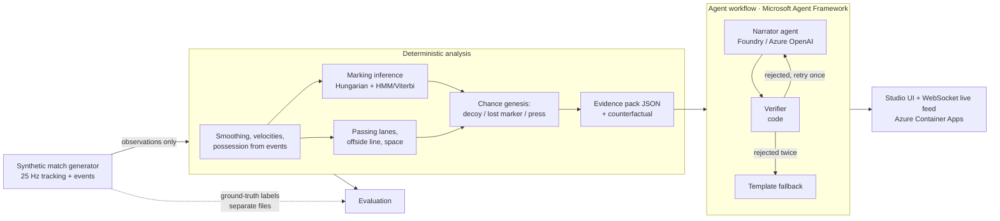

# Chance Genesis

**Others detect tactics; we measure how accurately we detect them — against ground truth, under noise.
And we explain *why* a chance happened, separating a defender who was pulled out of position by design
from one who simply switched off.**

Chance Genesis watches 25 Hz tracking data. When a shot happens it traces the previous ten seconds back
to the cause — a decoy run, a lost marker or a pressing trap — measures each action's contribution with a
counterfactual ("if the centre-back had stayed, the space would have been…"), and hands a verified
explanation to the studio while the replay is still running.

Built for the Microsoft × Premier League *Inside the Game* hackathon (Synthetic Match Insights Engine for
Premier League Studio). All data is synthetic; the league, clubs and players are fictional.


<!-- RESULTS:START -->
## Results on a held-out test set

280 held-out scenarios (40 per kind, seeds never used for tuning), 0.3 m tracking noise. Full tables: [eval/results/RESULTS.md](eval/results/RESULTS.md).

| Metric | Result |
|---|---|
| Cause attribution accuracy (7 scenario kinds, 4 classes) | **90.4%** |
| Real causes: cause **and** key players correct | **80.8%** |
| Hard negatives wrongly given a tactical cause | **3.1%** |
| Median error of the detected start of the cause | 0.78 s |
| Decoy run: precision / recall | 100.0% / 65.0% |
| Lost marker: precision / recall | 78.0% / 80.0% |
| Pressing trap: precision / recall | 100.0% / 100.0% |
| Marking inference, frame accuracy (Viterbi) | 88.6% |
| Accuracy under correlated tracking error 0.3 / 0.6 / 1.0 m | 90.7% / 88.6% / 80.7% |
| Full 90-minute match analysed in | 11.4 s (474× real time) |
| Per-frame live stage, p50 / p99 | 0.21 / 0.57 ms (budget 40 ms) |
| Cause tracing after a shot, median | 2.7 ms |
| Generator: distance per player per 90 / sprints per 90 | 10.5 km / 33 |


<!-- RESULTS:END -->

## Why this problem

When a goal goes in, the replay starts within seconds. The studio's question is not *what* happened —
everyone just saw it — but *why it was open*: whose run created the space, and whether the defender who
left it was doing his job or not. Today that analysis arrives after the break, from an analyst scrubbing
footage. Tracking-based tools describe states ("who marks whom", "the offside line"); they rarely say
which action caused the chance, and almost none report how often they are right.

Chance Genesis does three things the replay team can use immediately:

1. **Names the cause** of each chance and the players involved, with the moment it started.
2. **Separates design from failure**: a centre-back dragged out by a decoy run (followed his man, as
   instructed) versus one who stopped tracking his runner. The two look identical on the replay.
3. **Quantifies it** with a counterfactual: the space and nearest-defender distance if the key defender
   had done otherwise.

Every number is computed by deterministic code; the language model only writes the sentence, and a
verifier rejects any sentence whose numbers, times or player ids are not in the evidence.

## How it works



### 1. Synthetic data with hidden ground truth (`gen/`)

The challenge allows only synthetic data, so the generator is part of the product: 22 agents with
formation anchors (4-3-3 vs 4-4-2) that shift with the ball, Ornstein–Uhlenbeck off-ball movement, speed
and acceleration limits, and ball possession driven by passes and tackles. Scripted chances override only
a handful of players; everyone else keeps behaving normally.

Marking in the generator uses a **different mechanism from the detector**, so the evaluation is not
circular: a defender owns attackers in his *formation anchor's* Voronoi cell, picks them up after a random
reaction delay, releases them on a role-dependent leash, randomly swaps with neighbours, and chases a
goal-side point computed from where the attacker was 0.3–0.6 s ago. The detector never sees any of this.

Scenario kinds (40 held-out test episodes each, 280 in total):

| Kind | Ground-truth cause | What happens |
|---|---|---|
| `decoy_run` | decoy run | A striker runs wide or deep, his marker follows, a team-mate receives in the space the marker left |
| `lost_marker` | lost marker | An attacker runs in behind; his marker stops tracking for 1.3–2.0 s |
| `press_turnover` | pressing trap | Three players close the carrier and his short lanes deep in his half, intercept, shoot fast |
| `neg_nofollow` | none | The same wide run, but the marker holds his zone: nobody is dragged |
| `neg_outpaced` | none | The marker keeps chasing at full effort but is slower: individual pace, not a tactical failure |
| `neg_long` | none | Ordinary circulation ending in a long shot |
| `neg_unforced` | none | A high turnover from a loose pass that nobody forced |

The four `neg_*` kinds are hard negatives built to look like the real causes: the same run without a
following marker, a marker who tries but is slower, and a high turnover that nobody forced.

### 2. Marking inference (`analysis/marking.py`)

Per frame, a 10×20 cost matrix (10 defenders × 10 attackers + 10 "zone" columns) is solved with the
Hungarian algorithm (`scipy.optimize.linear_sum_assignment`). The cost is the distance to the attacker's
goal-side marking point, plus a penalty for standing on the wrong side, a velocity-mismatch term, and a
reward for closing in. Raw matches flicker, so two smoothers are provided: a causal hysteresis rule for
live use and an HMM with Viterbi decoding for retrospective analysis.

### 3. Chance genesis (`analysis/genesis.py`)

From each shot the system goes back up to 10 s and tests three cause definitions:

- **Decoy run.** A defender was standing within 4 m of the spot where the shooter later received, was
  assigned (by the marking model) to a team-mate of the shooter, followed that team-mate's sprint
  (≥ 5.5 m/s) and ended ≥ 9 m away from the spot. Counterfactual: put the defender back where he was and
  recompute the space.
- **Lost marker.** The shooter's own marker (assigned to him for most of the previous 5 s, within 4 m)
  stayed below jogging pace (2.5 m/s) for at least 0.6 s while his man sprinted (> 4.5 m/s), and the gap
  grew to ≥ 6 m. If instead the marker kept running but covered ≥ 55 % of his man's distance, the system
  reports *outpaced* — an individual, non-tactical pattern. Counterfactual: the marker keeps his starting gap.
- **Pressing trap.** The ball was lost within 40 m of the loser's goal line, the nearest presser had
  closed ≥ 4 m to within 4 m of the carrier (or was already that tight for 1 s), at least three opponents
  were within 20 m, and the shot came within 10 s. Evidence includes which presser blocked which passing
  lane (interception-time model: 0.3 s reaction, 7 m/s run, 15 m/s pass). Counterfactual: remove the
  busiest presser and recount the open lanes.

Space is a time-to-intercept dominant region: each cell belongs to the team that can reach it first.

The output is an **evidence pack** — the shared state every agent reads:

```json
{"moment_id": "shot_B6_83_56", "cause": "decoy_run", "verdict_type": "pulled_by_design",
 "chain": [{"t": "83:51-83:55", "actor": "B10", "action": "decoy run (wide)", "dragged": "A4",
            "dragged_m": 16.8, "space_m2": [83.0, 128.0]},
           {"t": "83:54", "actor": "B8", "action": "pass into the vacated space", "receiver": "B6"},
           {"t": "83:55", "actor": "B6", "action": "received in vacated space", "nearest_defender_m": 5.0},
           {"t": "83:56", "actor": "B6", "action": "shot", "distance_to_goal_m": 25.8}],
 "counterfactual": {"assumption": "A4 stays where he was before B10's run",
                    "space_m2_actual": 128.0, "space_m2_counterfactual": 54.0,
                    "nearest_defender_m_actual": 5.0, "nearest_defender_m_counterfactual": 2.5}}
```

The narration the workflow produced for it (offline template writer; every number checked):

> 83:56 Shot by B6. It was created by B10's decoy run: between 83:51-83:55 he went wide and A4, who was
> marking him, was dragged 16.8 m away. The space around the spot where the shot was set up grew from
> 83 m² to 128 m², and B6 received there at 83:55 with the nearest defender 5.0 m away. If A4 had stayed
> where he was, the model puts that space at 54 m² and the nearest defender 2.5 m away. The tracking model
> shows A4 following his man rather than losing him: he was pulled out by design.

### 4. Agents (`agents/`, Microsoft Agent Framework)

A `WorkflowBuilder` graph with three executors:

- **Narrator** — an Agent Framework `Agent` on Microsoft Foundry (or Azure OpenAI) with structured
  output: every sentence lists the evidence fields it cites.
- **Verifier** — deterministic code. Every number, clock time and player id must exist in the pack, and
  every number must be found in the fields its sentence cites; no blame language; the primary cause and
  key players must be named. A rejected draft goes back to the Narrator with the list of problems.
- **Fallback** — after a second rejection (or a model outage) a template narration that always verifies.

A separate **Tactical Analyst** agent (its own instructions, same client) writes a studio note for each
half from a period summary, through the same verify / retry / fallback workflow. The UI
shows how many facts were checked and whether a draft was rejected first. Narration can be requested in
English, Spanish, French or Chinese; the verifier is language-independent (it checks numbers, times and ids).

`tests/test_llm_path.py` runs the real `Agent.run` path against a local fake model that invents a number in
its first draft, and checks that the verifier rejects it, the feedback reaches the second prompt, and the
corrected draft is accepted. `tests/test_agents.py` covers the fallback after two rejections and after a
model outage.

### 5. Studio UI and live feed (`server/`, `web/`)

FastAPI serves a single-page studio view: a 2D pitch with telestrator overlays (who marks whom, passing
lanes, the vacated space, the counterfactual defender drawn as a dashed ghost), the cause card, the causal
chain (click a step to jump to its frame) and the verified narration. In **Live** mode a WebSocket streams
the match; when a shot happens the evidence pack is pushed immediately, the narration follows when the
workflow finishes, and the replay starts automatically.

## Evaluation protocol

`python -m eval.run_eval` regenerates every number in this README.

- Detector thresholds were tuned on development seeds 100–299 only. Test episodes use seeds ≥ 10000.
- The analysis receives observations only (noisy tracking + event feed). Labels are read afterwards, by
  the scorer. A unit test fails if any analysis module imports the generator.
- Noise: independent Gaussian error per frame, and temporally correlated error (AR(1), 1 s correlation
  time), which smoothing cannot remove.
- A cause counts as correct only for the primary cause; "players correct" requires the runner *and* the
  dragged defender (decoy), the defender *and* the attacker (lost marker), or the ball winner (press).

Generator realism (full 90-minute match) is calibrated against published figures: about 105 km per team
per Premier League match and about 30 sprints per player
([PlayerData](https://www.playerdata.com/blog/world-cup-spotlight)), and high-intensity running
(≥ 19.8 km/h) taking about 3 % of match time ([Bradley et al., Sunderland repository](https://sure.sunderland.ac.uk/3476)).

## Run it

```bash
python -m venv .venv && source .venv/bin/activate
pip install -r requirements-dev.txt
python -m server.prepare            # builds the 90-minute demo match (1-2 minutes)
uvicorn server.app:app --port 8000  # open http://localhost:8000
python -m eval.run_eval             # full evaluation (4-9 minutes on one core)
pytest -q
```

Narration backend, first one configured wins (otherwise the offline template writer is used):

```bash
export FOUNDRY_PROJECT_ENDPOINT=https://<project>.services.ai.azure.com/api/projects/<name>
export FOUNDRY_MODEL=gpt-4.1-mini            # your deployment name; auth via az login / managed identity
# or
export AZURE_OPENAI_ENDPOINT=https://<resource>.openai.azure.com
export AZURE_OPENAI_DEPLOYMENT=gpt-4.1-mini
export AZURE_OPENAI_API_KEY=<key>
```

Deploy to Azure Container Apps: `./deploy/aca.sh` (see the script header: Foundry with managed identity,
or Azure OpenAI with a key or managed identity).

## Microsoft technology used

| Technology | Where |
|---|---|
| Microsoft Agent Framework (`Agent`, structured output, `WorkflowBuilder`, executors) | `agents/narrator.py`, `agents/workflow.py` |
| Microsoft Foundry / Azure OpenAI (chat models) | Narrator and Tactical Analyst agents |
| Azure Container Apps | `Dockerfile`, `deploy/aca.sh` (managed identity for Foundry) |
| Azure Identity (`DefaultAzureCredential`) | keyless auth to Foundry |

## Repository layout

```
common/   pitch geometry and player indexing
gen/      generator.py (physics, marking, possession), scripts.py (scenarios), episodes.py (episodes, matches, observation layer)
analysis/ preprocess, phases, marking, offside, lanes, space, genesis, pipeline
agents/   narrator.py (Agent Framework agents), verifier.py, templates.py, workflow.py
server/   prepare.py (demo match), app.py (FastAPI + WebSocket)
web/      index.html (studio UI)
eval/     run_eval.py, results/ (RESULTS.md, results.json, noise_curve.png)
tests/    pipeline and agent-workflow tests
```

## Limitations

- The generator is a model of football, not football. Scenario scripts and detector rules share football
  definitions (a decoy run ends with someone receiving where the dragged defender stood), so these numbers
  show the detector recovers causes that are present in data like this; they are not a claim about real
  matches. The analysis code reads only positions and events, so it can be pointed at real tracking data
  unchanged — that is the next test.
- Decoy-run recall is the weakest number: the detector requires the receiver to arrive within 4 m of the
  dragged defender's starting spot and misses wider spaces.
- Tracking error is modelled as Gaussian (independent or AR(1)); identity swaps and occlusions are not.
- One cause per chance plus secondary factors; chances with several equally important causes are not
  labelled as such by the generator.
- "Individual quality" (a dribble, a burst of pace) is reported only in the *outpaced* form.

## License

MIT
