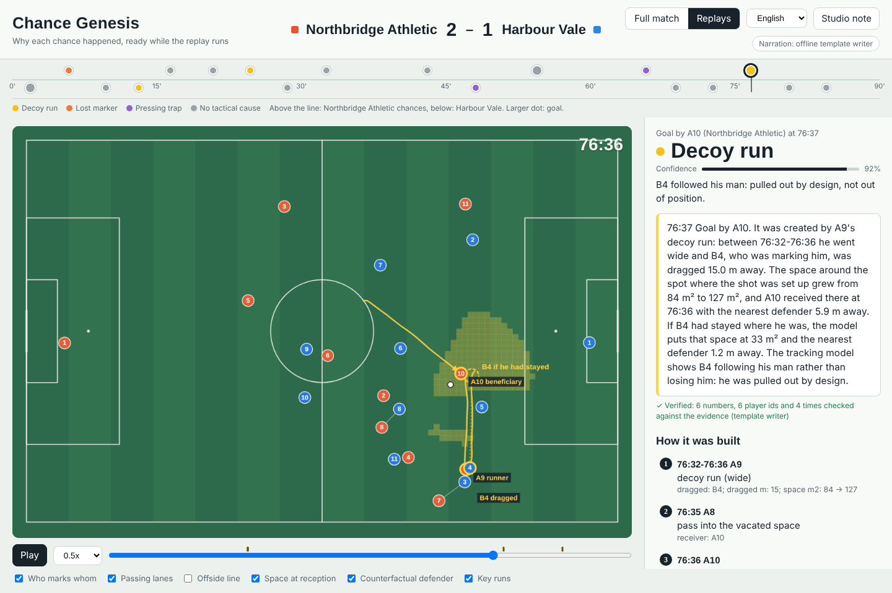
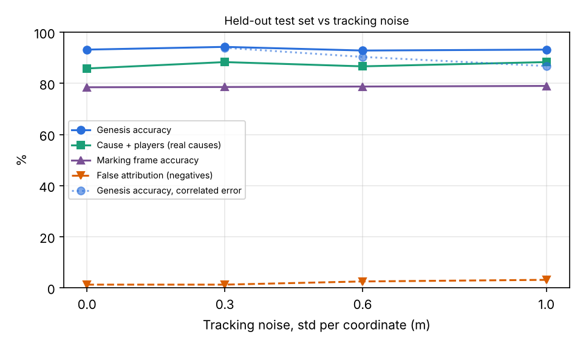
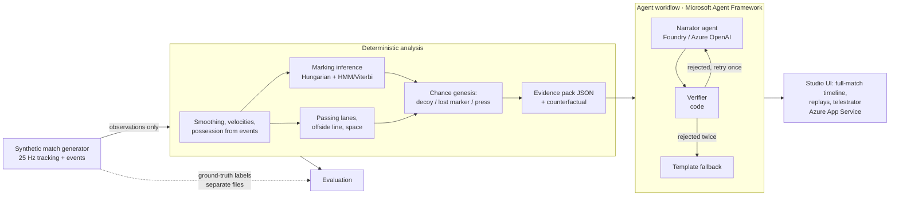
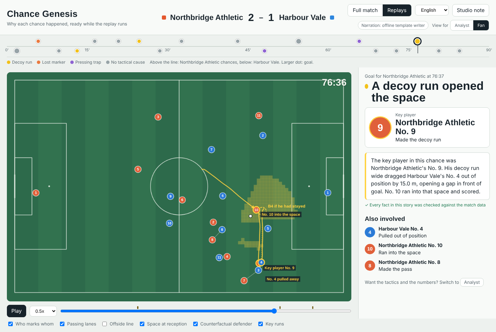

# Chance Genesis

**Others detect tactics; we measure how accurately we detect them — against ground truth, under noise.
And we explain *why* a chance happened, separating a defender who was pulled out of position by design
from one who simply switched off.**

Chance Genesis watches 25 Hz tracking data. When a shot happens it traces the previous ten seconds back
to the cause — a decoy run, a lost marker or a pressing trap — measures each action's contribution with a
counterfactual ("if the centre-back had stayed, the space would have been…"), and hands a verified
explanation to the studio while the replay is still running.

Built for the Microsoft × Premier League *Inside the Game* hackathon (Synthetic Match Insights Engine for
Premier League Studio). All data is synthetic; the league, clubs and players are fictional.



<!-- RESULTS:START -->
## Results on a held-out test set

280 held-out scenarios (40 per kind, seeds never used for tuning), 0.3 m tracking noise. Full tables: [eval/results/RESULTS.md](eval/results/RESULTS.md).

| Metric | Result |
|---|---|
| Cause attribution accuracy (7 scenario kinds, 4 classes) | **94.3%** |
| Real causes: cause **and** key players correct | **88.3%** |
| Hard negatives wrongly given a tactical cause | **1.2%** |
| Median error of the detected start of the cause | 0.72 s |
| Decoy run: precision / recall | 94.1% / 80.0% |
| Lost marker: precision / recall | 92.1% / 87.5% |
| Pressing trap: precision / recall | 100.0% / 97.5% |
| Marking inference, frame accuracy (Viterbi) | 78.6% |
| Accuracy under correlated tracking error 0.3 / 0.6 / 1.0 m | 93.9% / 90.4% / 86.8% |
| Full 90-minute match analysed in | 8.1 s (671× real time) |
| Per-frame live stage, p50 / p99 | 0.16 / 0.38 ms (budget 40 ms) |
| Cause tracing after a shot, median | 1.5 ms |
| Generator: distance per player per 90 / sprints per 90 | 11.4 km / 28 |


<!-- RESULTS:END -->

## Why this problem

When a goal goes in, the replay starts within seconds. The studio's question is not *what* happened —
everyone just saw it — but *why it was open*: whose run created the space, and whether the defender who
left it was doing his job or not. Today that analysis arrives after the break, from an analyst scrubbing
footage. Tracking-based tools describe states ("who marks whom", "the offside line"); they rarely say
which action caused the chance, and almost none report how often they are right.

Chance Genesis does three things the replay team can use immediately:

1. **Names the cause** of each chance and the players involved, with the moment it started.
2. **Separates design from failure**: a centre-back dragged out by a decoy run (followed his man, as
   instructed) versus one who stopped tracking his runner. The two look identical on the replay.
3. **Quantifies it** with a counterfactual: the space and nearest-defender distance if the key defender
   had done otherwise.

Every number is computed by deterministic code; the language model only writes the sentence, and a
verifier rejects any sentence whose numbers, times or player ids are not in the evidence.

## How it works



### 1. Synthetic data with hidden ground truth (`gen/`)

The challenge allows only synthetic data, so the generator is part of the product. It is a 25 Hz
multi-agent simulation built to look like a match, not like a diagram:

- **Team shape.** 4-3-3 against 4-4-2. Each team holds its shape around a reference point that follows
  the ball with a 1.5 s lag, so blocks slide and recover instead of snapping. Players have their own top
  speed (7.8–9.2 m/s), acceleration limit and a small dead zone, so they stand still between shifts rather
  than jittering.
- **Attacking.** Players look for space on their own: the two nearest team-mates offer angles either side
  of the carrier, forwards make runs in behind, and a carrier with space in front dribbles into it
  (shielding and slowing only when an opponent is within 4 m).
- **Defending is zonal**, with ball-side pressure: the nearest defender presses, the next one covers, and
  the rest lean toward the attacker in their zone, more tightly near their own box. Tight man-to-man
  tracking appears only where it would in a match (a run toward goal) or where a scenario needs it.
- **The ball is simulated**, not attached to players: passes are aimed at where the receiver will be,
  decelerate, can be cut out by anyone near the line, roll on as a loose ball when nobody gets there, and
  are taken without the ball snapping to the receiver. The keeper holds saves; a miss means a goal kick and
  a goal means a kick-off, with the taker walking to the ball first.

Scripted chances override only a handful of players; everyone else keeps behaving normally. The demo
match uses a broadcast-style feed error (slow AR(1) drift plus 5 cm flicker), and the studio view applies a
display-only smoothing pass.

Marking in the generator uses a **different mechanism from the detector**, so the evaluation is not
circular: zone responsibility around each defender's shape anchor, a lean toward the attacker in his zone,
a random reaction delay of 0.3–0.6 s, and a goal-side point computed from where the attacker *was*. The
ground-truth label says "marking" only when the lean is strong or the defender is pressing. The detector
never sees any of this.

Scenario kinds (40 held-out test episodes each, 280 in total):

| Kind | Ground-truth cause | What happens |
|---|---|---|
| `decoy_run` | decoy run | A striker runs wide or deep, his marker follows, a team-mate receives in the space the marker left |
| `lost_marker` | lost marker | An attacker runs in behind; his marker stops tracking for 1.3–2.0 s |
| `press_turnover` | pressing trap | Three players close the carrier and his short lanes deep in his half, intercept, shoot fast |
| `neg_nofollow` | none | The same wide run, but the marker holds his zone: nobody is dragged |
| `neg_outpaced` | none | The marker keeps chasing at full effort but is slower: individual pace, not a tactical failure |
| `neg_long` | none | Ordinary circulation ending in a long shot |
| `neg_unforced` | none | A high turnover from a loose pass that nobody forced |

The four `neg_*` kinds are hard negatives built to look like the real causes: the same run without a
following marker, a marker who tries but is slower, and a high turnover that nobody forced.

### 2. Marking inference (`analysis/marking.py`)

Per frame, a 10×20 cost matrix (10 defenders × 10 attackers + 10 "zone" columns) is solved with the
Hungarian algorithm (`scipy.optimize.linear_sum_assignment`). The cost is the distance to the attacker's
goal-side marking point, plus a penalty for standing on the wrong side, a velocity-mismatch term, and a
reward for closing in. Raw matches flicker, so two smoothers are provided: a causal hysteresis rule for
live use and an HMM with Viterbi decoding for retrospective analysis.

### 3. Chance genesis (`analysis/genesis.py`)

From each shot the system goes back up to 10 s and tests three cause definitions:

- **Decoy run.** A defender was standing within 5 m of the spot where the shooter later received, was
  assigned (by the marking model) to a team-mate of the shooter, followed that team-mate's sprint
  (≥ 5.5 m/s) and ended ≥ 9 m away from the spot. Counterfactual: put the defender back where he was and
  recompute the space.
- **Lost marker.** The shooter's own marker (assigned to him for most of the previous 5 s, within 2.5 m
  of him for at least 1 s, so it really was a marking job) stayed below jogging pace (2.5 m/s) for at
  least 0.9 s while his man sprinted (> 4.5 m/s), and the gap at the reception was ≥ 5 m. If instead the marker kept running but covered ≥ 55 % of his man's distance, the system
  reports *outpaced* — an individual, non-tactical pattern. Counterfactual: the marker keeps his starting gap.
- **Pressing trap.** The ball was lost within 40 m of the loser's goal line, the nearest presser had
  closed ≥ 4 m to within 4 m of the carrier (or was already that tight for 1 s), at least three opponents
  were within 20 m, and the shot came within 10 s. Evidence includes which presser blocked which passing
  lane (interception-time model: 0.3 s reaction, 7 m/s run, 15 m/s pass). Counterfactual: remove the
  busiest presser and recount the open lanes.

Space is a time-to-intercept dominant region: each cell belongs to the team that can reach it first.

The output is an **evidence pack** — the shared state every agent reads:

```json
{"moment_id": "goal_A10_76_37", "cause": "decoy_run", "verdict_type": "pulled_by_design",
 "chain": [{"t": "76:32-76:36", "actor": "A9", "action": "decoy run (wide)", "dragged": "B4",
            "dragged_m": 15.0, "space_m2": [84.0, 127.0]},
           {"t": "76:35", "actor": "A8", "action": "pass into the vacated space", "receiver": "A10"},
           {"t": "76:36", "actor": "A10", "action": "received in vacated space", "nearest_defender_m": 5.9},
           {"t": "76:37", "actor": "A10", "action": "shot", "distance_to_goal_m": 24.8}],
 "counterfactual": {"assumption": "B4 stays where he was before A9's run",
                    "space_m2_actual": 127.0, "space_m2_counterfactual": 33.0,
                    "nearest_defender_m_actual": 5.9, "nearest_defender_m_counterfactual": 1.2}}
```

The narration the workflow produced for it (offline template writer; every number checked):

> 76:37 Goal by A10. It was created by A9's decoy run: between 76:32-76:36 he went wide and B4, who was
> marking him, was dragged 15.0 m away. The space around the spot where the shot was set up grew from
> 84 m² to 127 m², and A10 received there at 76:36 with the nearest defender 5.9 m away. If B4 had stayed
> where he was, the model puts that space at 33 m² and the nearest defender 1.2 m away. The tracking model
> shows B4 following his man rather than losing him: he was pulled out by design.

### 4. Agents (`agents/`, Microsoft Agent Framework)

A `WorkflowBuilder` graph with three executors:

- **Narrator** — an Agent Framework `Agent` on Microsoft Foundry (or Azure OpenAI) with structured
  output: every sentence lists the evidence fields it cites.
- **Verifier** — deterministic code. Every number, clock time and player id must exist in the pack, and
  every number must be found in the fields its sentence cites; no blame language; the primary cause and
  key players must be named. A rejected draft goes back to the Narrator with the list of problems.
- **Fallback** — after a second rejection (or a model outage) a template narration that always verifies.

Two more agents share the client and the same verify / retry / fallback workflow: the **Fan
Commentator** writes the fan view of a chance (see Personalisation below), and the **Tactical Analyst**
writes a studio note for each half from a period summary. The UI
shows how many facts were checked and whether a draft was rejected first. Narration can be requested in
English, Spanish, French or Chinese; the verifier is language-independent (it checks numbers, times and ids).

`tests/test_llm_path.py` runs the real `Agent.run` path against a local fake model that invents a number in
its first draft, and checks that the verifier rejects it, the feedback reaches the second prompt, and the
corrected draft is accepted. `tests/test_agents.py` covers the fallback after two rejections and after a
model outage.

### 5. Studio UI (`server/`, `web/`)

FastAPI serves a single-page studio view with two modes:

- **Full match**: the whole 90 minutes on a scrubbable timeline (drag anywhere, play at 0.25–8×). Chances
  are marked on the timeline in their cause colour; when playback crosses one, a banner names the cause and
  opens the explanation. The match is shipped to the browser once as compact binary arrays (about 8 MB
  before compression), so scrubbing is instant.
- **Replays**: each chance with telestrator overlays (who marks whom, passing lanes, the vacated space,
  the counterfactual defender drawn as a dashed ghost), the cause card, the causal chain (click a step to
  jump to its frame) and the verified narration.

### 6. Personalisation: analyst and fan views

The same verified facts reach two audiences, switched with **View for: Analyst | Fan** at the top right:

- **Analyst** — the cause, verdict, causal chain and counterfactual, plus *By the numbers*: top speed,
  distance and sprinting distance of every player involved in the seconds before the shot, shot speed,
  distance and goal angle, key-pass distance and ball speed, and the length of the move. All measured
  from the tracking data and the event feed (`stats` in the evidence pack).
- **Fan** — who mattered most and what he did, in plain words: *"The key player in this chance was
  Northbridge Athletic's No. 9. His decoy run wide dragged Harbour Vale's No. 4 out of position by 15.0 m,
  opening a gap in front of goal. No. 10 ran into that space and scored."* The key player is chosen by code
  (`key_player`: the decoy runner, the runner who lost his marker, the ball winner of a press, or the
  shooter), with the opponent he beat and the supporting players. Fans see shirt numbers and club names,
  not ids; the verifier checks shirt numbers against the evidence the same way it checks ids. On the
  pitch the key player is labelled as such.

Both views can be requested in English, Spanish, French or Chinese.



The live path is in place for a real feed: `/ws/live` streams the match frame by frame, runs the per-frame
stage, and pushes the evidence pack the moment a shot is detected; the studio currently uses the
scrubbable view.

## Evaluation protocol

`python -m eval.run_eval` regenerates every number in this README.

- Detector thresholds were tuned on development seeds 100–299 only. Test episodes use seeds ≥ 10000.
- The analysis receives observations only (noisy tracking + event feed). Labels are read afterwards, by
  the scorer. A unit test fails if any analysis module imports the generator.
- Noise: independent Gaussian error per frame, and temporally correlated error (AR(1), 1 s correlation
  time), which smoothing cannot remove.
- A cause counts as correct only for the primary cause; "players correct" requires the runner *and* the
  dragged defender (decoy), the defender *and* the attacker (lost marker), or the ball winner (press).

Generator realism (full 90-minute match) is checked against published figures: about 105 km per team
per Premier League match and about 30 sprints per player
([PlayerData](https://www.playerdata.com/blog/world-cup-spotlight)), and high-intensity running
(≥ 19.8 km/h) taking about 3 % of match time ([Bradley et al., Sunderland repository](https://sure.sunderland.ac.uk/3476)).
The generator gives 11.4 km and 28 sprints per outfield player per 90; its speed profile is about 12 %
standing, 46 % walking, 29 % jogging and 13 % running or faster.

## Run it

```bash
python -m venv .venv && source .venv/bin/activate
pip install -r requirements-dev.txt
python -m server.prepare            # builds the 90-minute demo match (1-2 minutes)
uvicorn server.app:app --port 8000  # open http://localhost:8000
python -m eval.run_eval             # full evaluation (4-9 minutes on one core)
pytest -q
```

### Microsoft Foundry (narration agents)

Without any configuration the app uses the offline template writer. To run the Narrator and Tactical
Analyst agents on a Foundry model (keyless, Entra ID):

```bash
az login
RG=rg-chance-genesis; RES=<globally-unique-name>; PROJ=chance-genesis; LOC=eastus
az group create -n $RG -l $LOC
az cognitiveservices account create -n $RES -g $RG --kind AIServices --sku S0 -l $LOC \
  --custom-domain $RES --assign-identity --allow-project-management true
az cognitiveservices account project create -n $RES -g $RG --project-name $PROJ -l $LOC
az cognitiveservices account deployment create -n $RES -g $RG --deployment-name gpt-5-mini \
  --model-name gpt-5-mini --model-version 2025-08-07 --model-format OpenAI \
  --sku-name GlobalStandard --sku-capacity 10
# your own account needs the Foundry User role on the project
PROJECT_ID=$(az cognitiveservices account project show -n $RES -g $RG --project-name $PROJ --query id -o tsv)
az role assignment create --role 53ca6127-db72-4b80-b1b0-d745d6d5456d \
  --assignee-object-id "$(az ad signed-in-user show --query id -o tsv)" --assignee-principal-type User \
  --scope $PROJECT_ID

export FOUNDRY_PROJECT_ENDPOINT=$(az cognitiveservices account project show -n $RES -g $RG \
  --project-name $PROJ --query 'properties.endpoints."AI Foundry API"' -o tsv)
export FOUNDRY_MODEL=gpt-5-mini
python -m scripts.check_azure        # narrates one chance through the agent workflow and reports the backend
```

Reasoning models (gpt-5*, o*) are called without `temperature` and with low reasoning effort
(`NARRATOR_REASONING_EFFORT`); the narrator also falls back automatically if a deployment rejects a
parameter. Azure OpenAI works too: set `AZURE_OPENAI_ENDPOINT`, `AZURE_OPENAI_DEPLOYMENT` and, optionally,
`AZURE_OPENAI_API_KEY`.

**Tracing.** Set `APPLICATIONINSIGHTS_CONNECTION_STRING` and every workflow run, executor, agent call
and model call (with token usage) is exported to Application Insights through the Agent Framework's
OpenTelemetry instrumentation. Connect the same Application Insights resource to the Foundry project to
see the traces under Tracing in the Foundry portal.

**Deploy.** Two scripts, same variables (plus `FOUNDRY_PROJECT_ID` to grant the app's managed identity the
Foundry User role automatically):

- `./deploy/appservice.sh` — Azure App Service (Linux, Python). The platform builds the code, so no
  container registry is needed; this is what the hosted demo uses (Azure for Students subscriptions do not
  allow container builds). `startup.sh` builds the demo match on first start.
- `./deploy/aca.sh` — Azure Container Apps from the `Dockerfile`, on subscriptions with ACR Tasks.

## Microsoft technology used

| Technology | Where |
|---|---|
| Microsoft Agent Framework (`Agent`, structured output, `WorkflowBuilder`, executors) | `agents/narrator.py`, `agents/workflow.py` |
| Microsoft Foundry / Azure OpenAI (chat models) | Narrator, Fan Commentator and Tactical Analyst agents |
| Azure App Service (hosted demo) and Azure Container Apps | `deploy/appservice.sh`, `startup.sh`; `Dockerfile`, `deploy/aca.sh` (managed identity for Foundry) |
| Azure Identity (`DefaultAzureCredential`) | keyless auth to Foundry |
| Azure Monitor / Application Insights (OpenTelemetry) | `agents/telemetry.py`: agent and workflow traces, viewable in the Foundry portal |

## Repository layout

```
common/   pitch geometry and player indexing
gen/      generator.py (physics, marking, possession), scripts.py (scenarios), episodes.py (episodes, matches, observation layer)
analysis/ preprocess, phases, marking, offside, lanes, space, genesis, pipeline
agents/   narrator.py (Agent Framework agents), verifier.py, templates.py, workflow.py, telemetry.py
server/   prepare.py (demo match), app.py (FastAPI + WebSocket)
web/      index.html (studio UI)
scripts/  check_azure.py (smoke test for the Foundry / Azure OpenAI setup)
eval/     run_eval.py, results/ (RESULTS.md, results.json, noise_curve.png)
tests/    pipeline and agent-workflow tests
```

## Limitations

- The generator is a model of football, not football. Scenario scripts and detector rules share football
  definitions (a decoy run ends with someone receiving where the dragged defender stood), so these numbers
  show the detector recovers causes that are present in data like this; they are not a claim about real
  matches. The analysis code reads only positions and events, so it can be pointed at real tracking data
  unchanged — that is the next test.
- Decoy-run recall is the weakest number: the detector requires the receiver to arrive within 5 m of the
  dragged defender's starting spot and misses wider spaces.
- Marking-inference frame accuracy (about 79 %) is lower than the cause accuracy: most defending in the
  generator is zonal, and the line between "leaning toward the attacker in my zone" and "marking him" is
  soft in the labels as well as in football.
- The synthetic match has no throw-ins, free kicks or corners; play restarts only after shots.
- Tracking error is modelled as Gaussian (independent or AR(1)); identity swaps and occlusions are not.
- One cause per chance plus secondary factors; chances with several equally important causes are not
  labelled as such by the generator.
- "Individual quality" (a dribble, a burst of pace) is reported only in the *outpaced* form.

## License

MIT
